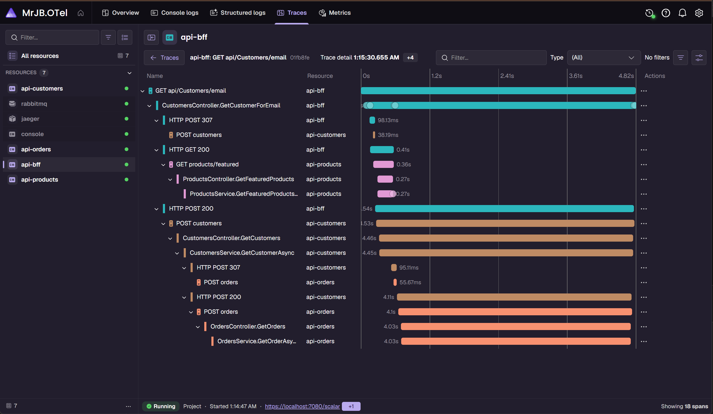

# .NET: Aspire with OpenTelemetry
.NET Aspire is a major game changer coming to .NET.

## Distributed Tracing
* Spans
* Track Slow Calls

A single request to the BFF (`GET api/Customers/email`) traced across every service in the Aspire dashboard. The BFF calls the Customers and Products APIs in parallel, and Customers in turn calls Orders, which is the slow call in this trace.

